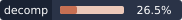

# Crazy Taxi decomp



A decompilation of the Dreamcast **Crazy Taxi**, in progress. A function is **done** when its C behaves like the original (Equivalent, checked by `tools/equiv.py`); byte-identical C (Matching) is the bonus tier. It rebuilds the game's
executable byte for byte from one assembly file per function, with Equivalent C for a growing
share of its functions (`src/`, `tests/`) and a few matching units; names, structures and what is known about the engine are in `docs/engine.md`,
and the Progress block below has the current counts.

**This repository contains no game code or data.** You supply your own disc; `setup.sh` generates
everything game-derived on your machine, and `.gitignore` keeps it out of git.

## Supported version

| | |
|---|---|
| Release | Crazy Taxi (Europe) (En,Ja), GD-ROM, MK-51035, V1.000, 2000-01-20 |
| `1ST_READ.BIN` | 1,477,040 bytes, SHA-1 `2756d6c828b5a3848189cd84cac62bc9cb0a94b7` |
| Linked at | `0x0C010000` |
| SDK era | Shinobi 1.62, KAMUI 1.11.0.1, ADXT 5.66 |

Other releases are different builds: `setup.sh` refuses them rather than produce a broken split.

## Building

You need: your own copy of the disc as a `.gdi` (a `.chd` converts with
`chdman extractcd -i game.chd -o game.gdi`), Python 3, Docker, and a Katana SDK (its Hitachi
assembler and linker do the build; any folder layout works).

```
bash setup.sh "path/to/your disc.gdi"
echo 'SDK_PATH="/path/to/katana-sdk"' > .env      # once: where your SDK is (not committed)
bash build.sh
```

`build.sh` should end with `MATCH`. It builds its own small tools image the first time (Docker
must be running). The first build assembles every file (a few minutes); after
that only changed files. (Running the scripts with `bash` means file permissions never matter;
`./build.sh` works too once `setup.sh` has run.) Docker is required; on Linux x86_64 without
Docker, `DC_LOCAL=1` runs the tools through `wibo` instead.

## What is here

| path | what |
|---|---|
| `setup.sh` | Extract and verify your executable, generate `asm/`, `text-map/` and `model-map/` |
| `build.sh` | Assemble, link, convert, compare with your original |
| `disc.sh` | Build a playable disc image of your version (files you put under `disc/`) |
| `textures.sh` | Optional: every standard texture on one page, to look through |
| `BASE` | Link address |
| `functions.txt` | Every function: address, size, name (`FUN_<addr>` = not named yet) |
| `globals.txt` | Named global variables: address, name |
| `symbols.txt` | Addresses the C units use that no file defines yet (RAM, data inside asm) |
| `sdk.txt` | The bundled Sega SDK's code (for `tools/progress.py`) |
| `models.txt` | What is known about the game's 3D models: tables, a skeleton, texture pairs, names (read by `tools/model_map.py`) |
| `model-map/` | The model map (generated by `setup.sh`, committed): see Model map below |
| `src/` | C: Equivalent files (checked by `tools/equiv.py`, not built) and matching C units (built, see below) |
| `tests/` | Test cases per function (`tests/<file>/<function>.json`) and `tests/equivalent.txt` |
| `docs/equivalent.md` | The evidence for each Equivalent function (written by `tools/equiv.py`) |
| `sdk-verified.txt` | Library functions whose bytes the SDK source you supplied reproduces (written by `tools/sdk_source.py`) |
| `sdk-source/` | The C of those library functions, from the SDK source you supplied (local, git-ignored) |
| `AGENTS.md` | The per-function decompilation loop: Equivalent first, Matching as the bonus |
| `docs/engine.md` | What is known about the game's code and data |
| `tools/` | Disc reader, splitter, text mapper, model mapper, C-unit layout, progress report, missed-function finder, SH-4 disassembler and simulator, the Equivalent check (`equiv.py`) with its helpers (`checksizes.py`, `classify.py`, `poollist.py`, `port_equiv.py`), the SDK-source check (`sdk_source.py`), live checks against the running game (optional) |

`text-map/` (generated) lists the executable's strings with every pointer to them, how much text each disc file holds
with the code that opens it, how text is drawn, and every image file (`images.tsv`). Counts and lists for you to read,
not a verdict.


## Model map

`setup.sh` also builds `model-map/game.dcgs` (with `tools/model_map.py`): every model it recognises in the disc files, the
table in the executable that holds it, the texture lists, every sound it recognises (CRI ADX and AHX streams, and the sound
banks), and, where a skeleton is known, characters assembled from their parts. It is plain tab-separated text in sections (`[models]`, `[assemblies]`, `[rigs]`, `[bones]`, `[audio]`, `[textures]`) and it is
**committed**: it holds addresses, offsets, sizes and names only, no game bytes or text (the text map is the one
that stays local). Regenerate it with `python3 tools/model_map.py 1ST_READ.BIN "$(cat BASE)" functions.txt "<your disc>.gdi" model-map`.

- **No setup needed to start.** With no rules the map still lists every model it recognises, grouped by the table that holds it.
  Models in a table are found by pointer, and the file each model lives in is loaded at an address the tool works out
  from the executable's own pointers.
- **`models.txt` is what is known about the game's models**, one rule per line: `chars` and `structs` (tables whose
  layout is understood), `rig` / `bone` / `assemble` (a skeleton posed from a motion record), `nodes` / `nodelayout` (linked node structs in
  the executable, each character placed in its bind pose), `textures` (pairs a
  model file with a texture file of another name; matching names are found by themselves), `note`, and the two a
  person adds by naming things: `name <file> <offset> <text>` (one model), `sound <file> <entry> <text>` (one sound) and `table <address> <group> <label>`
  (a whole table). The syntax is in the header of `tools/model_map.py`.
- **Naming convention.** A row shows the name first and the id beside it, and only the id when there is no name:
  `Axel  0x01`, `Torso  0x1D6EA8`, `0x080000`. Names are tidied the same way everywhere: words separated by single
  spaces (underscores and camelCase become spaces), each word starting with a capital, no parentheses. Ids (hex
  offsets, table addresses, the game's own identifiers) are not names and are never changed.
- **Naming things.** Edit `models.txt` and rerun the tool, or use a model viewer that opens this folder and writes
  the `name` and `table` lines for you: they go into two sorted blocks at the end of the file, so a naming session is
  a small `git diff`. Commit the diff; the next person's map starts from your names.
- **Textures.** Each texture list in the executable (width and height, data type, pixel format, address) is found by
  its shape and matched to the texture file it fits exactly, so most models come with their textures.

Characters 0x01-0x04 and again 0x3B-0x3E are the four cabbies in the order of the selection screen (Axel, B.D. Joe, Gena, Gus); 0x00 is an empty skeleton. Cars are named from the executable's own type table, and the four city archives (`BINC1`-`BINC3`) take their city's textures.

## Equivalent C and shared library code

`src/<file>.c` with no `@unit` header is C checked for behaviour only: `python3 tools/equiv.py src/<file>.c`
runs each function in an SH-4 interpreter twice per test case, the original bytes and your compiled C,
and they must agree on calls, memory writes and the result. Passing functions are listed in
`tests/equivalent.txt` and counted as done. The loop, and how to write many of them quickly, is in
`AGENTS.md` and the kickoff skill's `references/equivalent-pipeline.md`. Library code the game shares
with another decomp of this skill (the NAOMI library, the C runtime) need not be rewritten:
`python3 tools/port_equiv.py <that decomp> .` finds those functions here by their code, ports the C and
its cases, and keeps only what `equiv.py` confirms on this game's own bytes.

## Matching C units (the build tier)

A file `src/<name>.c` whose first line is `/* @unit <start>-<end> [shc options] */` replaces every
asm file in that address range. `build.sh` compiles it with the SDK's `shc` to assembly, lays it
out exactly like the original (`tools/fill.py`: alignment as nops, reserved gaps as `0xEE`, padded
to `<end>`), assembles it and links it in place; the result still has to `MATCH`. A unit with
constant data (initialised local arrays, const tables, string literals) also names where the
original link put that data: `/* @unit <start>-<end> @data <dstart>-<dend> [shc options] */`. The
data becomes its own piece at that range, in source order; both ranges must start and end on asm
file boundaries (add them to `functions.txt`: `F <addr> 0 FUN_<addr>` for a function start,
`D <addr> 0 data_<addr>` for a data boundary, which is not counted as a function). A unit is one
original source file: all its functions share literal pools, so it goes in only when all of it
matches. `python3 tools/progress.py` reports the state in several measures: done (equivalent C; matching C and SDK source part of it), named
functions and globals, and functions documented in `docs/*.md`.

## Progress

<!-- progress -->
```
THE GAME                          2827 functions, 452645 bytes of code; each function in one bucket
  done: equivalent C       26.7%  756 of 2827 functions, 29530 bytes (6.5%): C that behaves like the original
    of which matching C     0.3%  8 functions, 1178 bytes, 2 units: rebuilt byte for byte
    of which SDK source     7.9%  222 functions, 11678 bytes: the SDK's own source reproduces them (sdk-source/, local)
  named only               39.8%  1124 functions: a name, no C yet (not done work)
  unnamed                  33.5%  947 functions (FUN_...), no C yet
  documented               21.5%  607 named functions in docs/*.md
  named globals                   120
  of which library                1825 functions, 196796 bytes of code: the Sega SDK, the NAOMI library and the C runtime bundled in the game
    done                   33.6%  613 of 1825 library functions, 24082 bytes (12.2%)
    named                  73.0%  1333 of 1825 (the library's own names, from SDK tables)
REVERSE ENGINEERING               what the model map identifies; separate from the measures above, not done work
  models named             37.1%  1010 of 2724 models: a name, or a named table or collection
  characters named         15.5%  9 of 58 characters (note rules)
  sounds named              3.1%  22 of 716 sounds (sound rules)
  tables named              1.0%  1 of 96 model tables (table rules)
```
<!-- /progress -->

Updated on every commit by `tools/hooks/pre-commit` (enable once per clone:
`git config core.hooksPath tools/hooks`).

## Names

Names come from signature matching: 385 matches from the Katana SDK R10.1's own libraries, 112 more
from SDK R9 (the release closest to the game's library banners), and 30 from a names table since
dropped (only unique matches are applied); small wrappers inherit the name of the function they
call. The Progress block above has the current counts.
The rest were named by reading the code, using the original names from the Android build where a
function is identified; `docs/engine.md` has what is known about them.

## How this was started

The repo was started with
[dc-decomp-kickoff](https://github.com/consolesplayingconsoles/dc-decomp-kickoff), which gave it
the split, the build and the first names; its tools and build steps are kept in step with that
skill. Everything since (names, docs, matching C) is decomp work in this repo.

## Third-party sources

The build needs a Katana SDK. Repositories that hold such material (for example
`Kochise/dreamcast-docs`)
are named solely as examples of the type of material required. We have no affiliation with, and
make no representation regarding, those repositories, their contents, or their licensing. You are
solely responsible for determining whether you are entitled to obtain and use any such material.

Crazy Taxi and its publisher's trademarks belong to their owners. This project is not affiliated with
or endorsed by them.

## Where this comes from

It came out of real work on Consoles Playing Consoles. See what Pluto has helped me build:

- 📸 **Instagram:** [@consolesplayingconsoles](https://www.instagram.com/consolesplayingconsoles/)
- 🔗 **Everything else:** [beacons.ai/consolesplayingconsoles](https://beacons.ai/consolesplayingconsoles)

