# Crazy Taxi decomp


**Explore this decomp project with [Shuriken Explorer](https://consolesplayingconsoles.github.io/dc-shuriken-explorer/) and see the game's models, skeletons, animations, textures, images, sounds, text and side-by-side C and assembly code directly in your browser.**

**A complete decompilation of the Dreamcast Crazy Taxi**. It builds and plays. No issues are known, please report any.

It rebuilds the game's executable byte for byte.
A function is **done** when its C behaves like the original's code: `tools/equiv.py` runs both on test cases and compares
every register and memory write the original makes. The C is not the original's bytes. The game is built from it with the
movable build (`make c`), which compiles the C, lays it out where the original code was, and keeps the original's data and
library code at their addresses. How strong each function's proof is depends on how much of its code the cases run;
`docs/equivalent.md` lists that per function.

_**This is not a traditional, human-idiomatic decompilation.** It is structured and documented for AI consumption,
and its tooling is built for the automation and scale of that paradigm.
If needed, a human-idiomatic rewrite can start from it, as a fork or a new project.
This project constitutes a solid stepping stone for such a target: it contains equivalent C, the asset maps,
the Shuriken Explorer code and asset views, the build pipeline and the author's notes in [docs/engine.md](docs/engine.md)._

**This repository contains no game code or data.** You supply your own disc; `setup.sh` generates
everything game-derived on your machine, and `.gitignore` keeps it out of git.

## Build and run

You need: your own copy of the disc as a `.gdi` with its track files, Python 3, Docker, and a Katana SDK (its Hitachi
assembler and linker do the build; any folder layout works).
Docker must be running: the first build makes a small tools image and assembles every file (a few minutes). On Linux
x86_64 without Docker, `DC_LOCAL=1` runs the tools through `wibo` instead.

### On the Dreamcast

1. Read your disc and split the executable (once):

   ```
   make setup GDI="path/to/your disc.gdi"
   echo 'SDK_PATH="/path/to/katana-sdk"' > .env
   ```

2. Check the split rebuilds the original byte for byte (ends with `MATCH`):

   ```
   make
   ```

3. Build the game from the C into a copy of your disc:

   ```
   make disc GDI="path/to/your disc.gdi"
   ```

4. Play `build/disc-cbuild/Crazy Taxi (Europe) (En,Ja).gdi` in a Dreamcast emulator, or from a GDEMU SD card on the console.

### Native (x86-64 Linux)

See [port/README.md](port/README.md#to-bring-up-a-game).

## Progress

<!-- progress -->
```
TOTAL TEST COVERAGE           81.6%  the instructions the cases ran, of all instructions, over the 3188 functions that can be C; the 3148 functions that reached the check are measured, the others count 0
FUNCTIONS LEFT  (100.0% complete) 0  of the 3188 functions that can be C (8 with no C form are counted apart)
BYTES LEFT      (100.0% complete) 0  of 528578 bytes of code that can be C
FUNCTIONS                            
  unnamed                         0  functions still called FUN_... (0 of 3416)
  Not written C                   0  0 bytes
  Written C with errors           0  0 bytes
  Not drawn                       0  0 bytes
  Drawn with errors               0  0 bytes
  Checked with errors             0  0 bytes
  No C form                    0.2%  an instruction or a register convention with no C form
  documented                  93.5%  3195 named functions in docs/*.md
SDK                                  
  with C                      96.4%  2056 of 2132
  object code only             3.6%  76 of 2132
  not done                     0.0%  0 of 2132
  no C form                    2.1%  an instruction or a register convention with no C form
  hardware (from total)       25.9%  564 of 2178
GAME ASSETS (EXTRA)                  
  models named                37.1%  1010 of 2723 models: a name, or a named table or collection
  characters named            15.5%  9 of 58 characters (note rules)
  sounds named                 3.1%  22 of 716 sounds (sound rules)
  tables named                 1.1%  1 of 95 model tables (table rules)
```
<!-- /progress -->

Updated on every commit by `tools/hooks/pre-commit` (enable once per clone:
`git config core.hooksPath tools/hooks`).

## Examples

Mods built on top of this decomp, running on a real Dreamcast: an Extreme Tux Racer course, Doom's E1M1 and the Pac-Man maze, as playable levels, and Walking Tour on foot.
More pictures, how to build them and their licences are in the [examples README](examples/README.md).

<table>
  <tr>
    <td>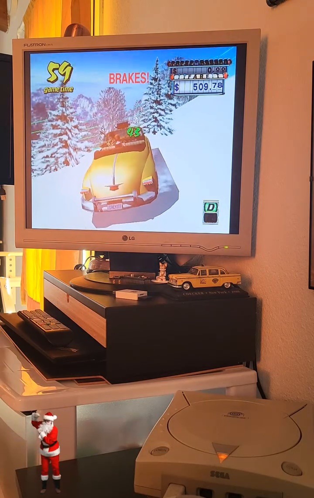</td>
    <td>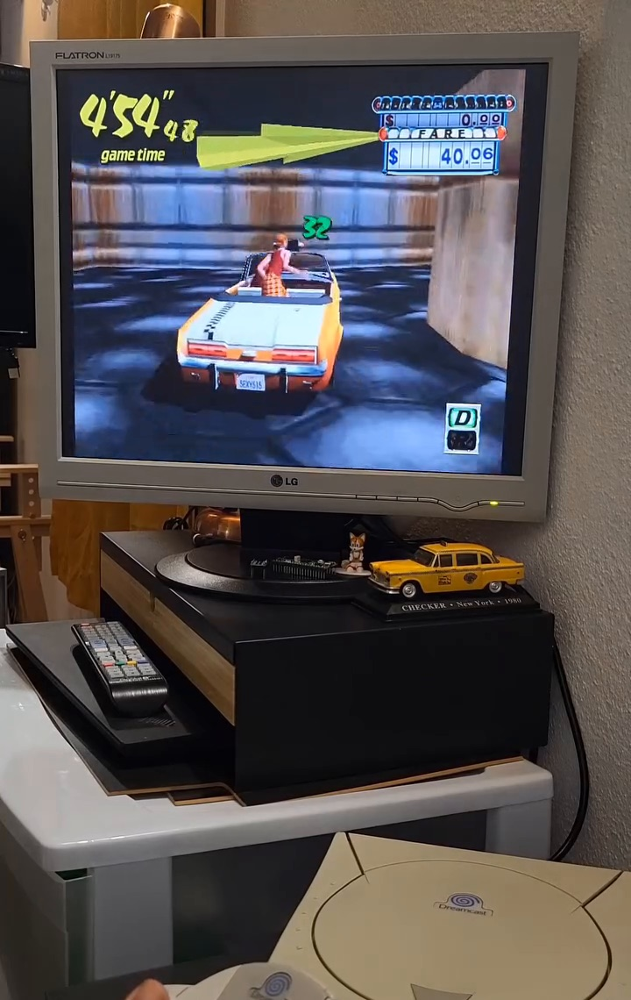</td>
    <td>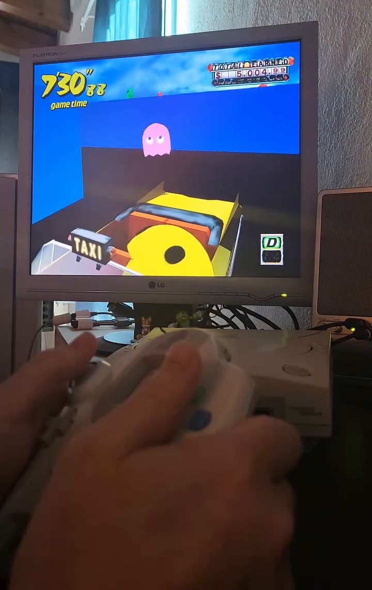</td>
    <td>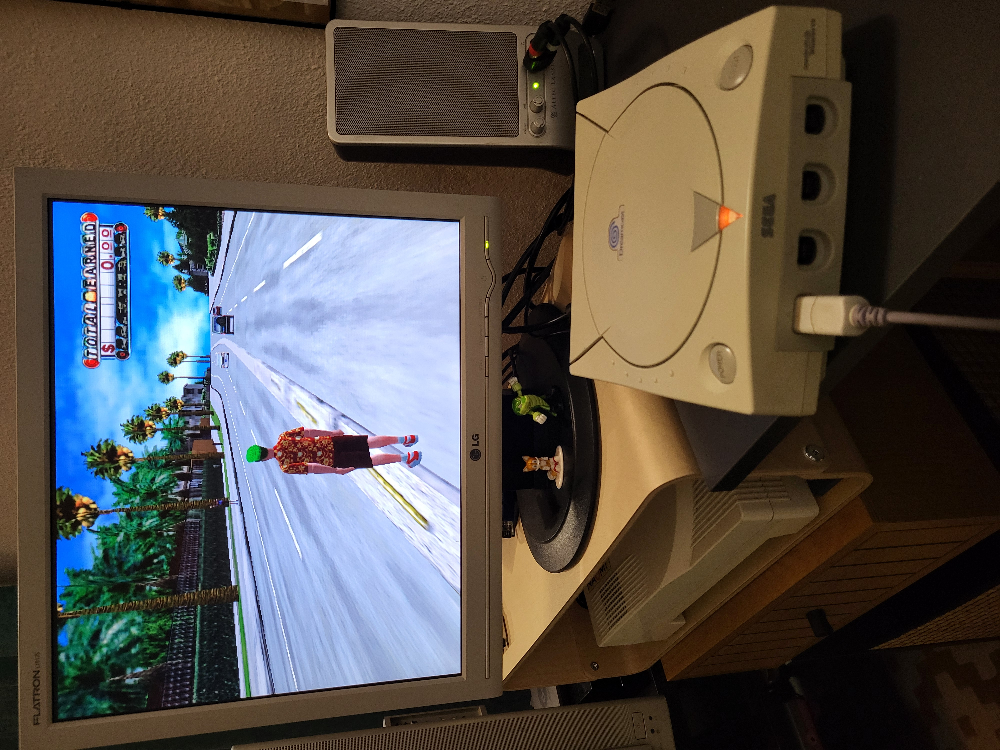</td>
  </tr>
  <tr>
    <td align="center"><a href="https://www.instagram.com/reel/DfCv8f5x_46/">Tux Racer Video</a></td>
    <td align="center"><a href="https://www.instagram.com/reel/DfF62DVxLiG/">Doom Video</a></td>
    <td align="center"><a href="https://www.instagram.com/reel/Dfy8q-7RTQ7/">Pac-Man Video</a></td>
    <td align="center"><a href="https://www.instagram.com/reel/DexUUJZxsxl/">Walking Tour Video</a></td>
  </tr>
</table>

### Other mods (not included)

Four Dragon Ball mods are built the same way on this decomp.

<table>
  <tr>
    <td>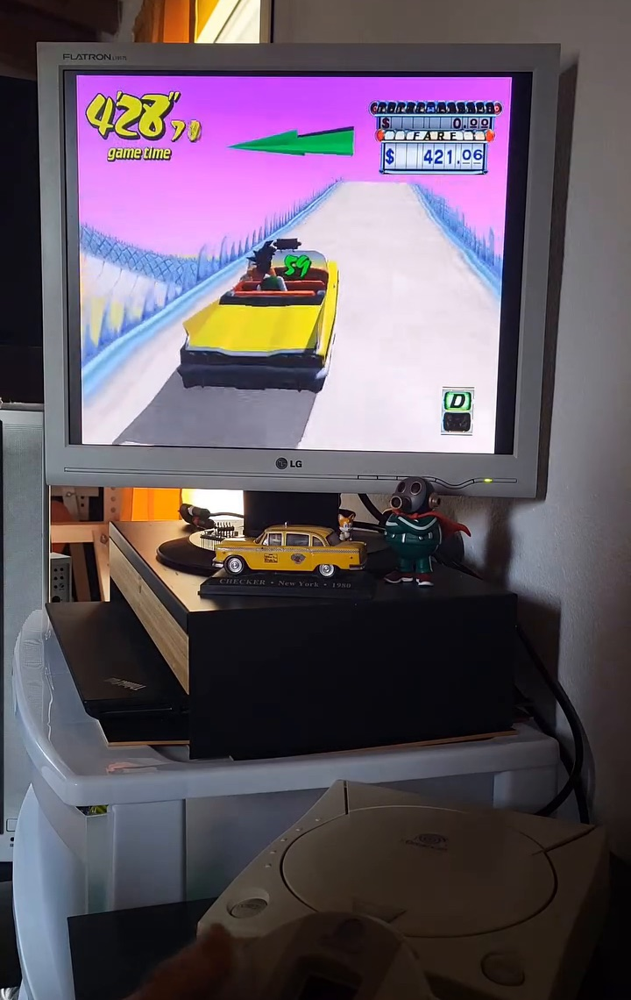</td>
    <td>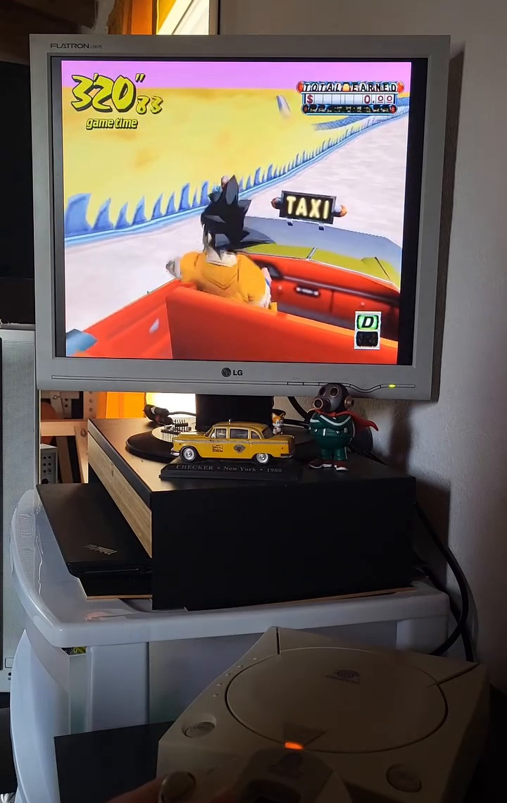</td>
  </tr>
  <tr>
    <td align="center" colspan="2"><a href="https://www.instagram.com/reel/DfRemPvRd4t/">Snake Way Video</a></td>
  </tr>
</table>

<table>
  <tr>
    <td>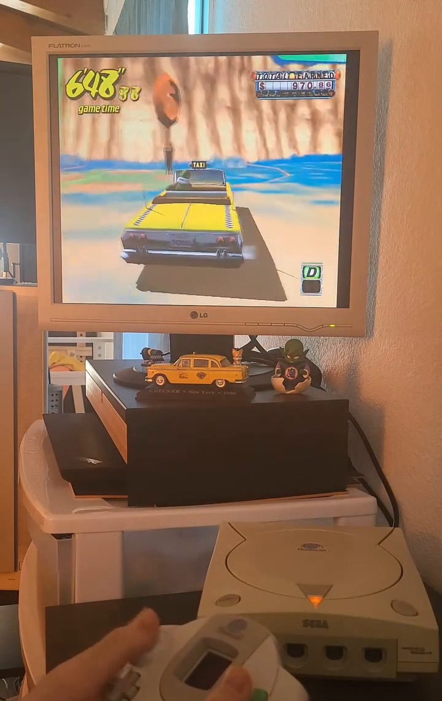</td>
    <td>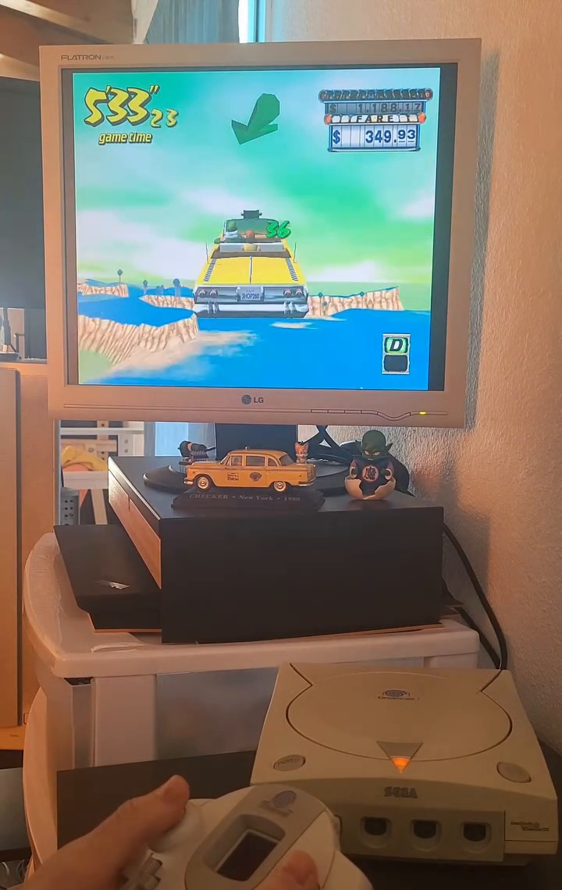</td>
  </tr>
  <tr>
    <td align="center" colspan="2"><a href="https://www.instagram.com/reel/DfXQBXJxI0P/">Namek Video</a></td>
  </tr>
</table>

<table>
  <tr>
    <td>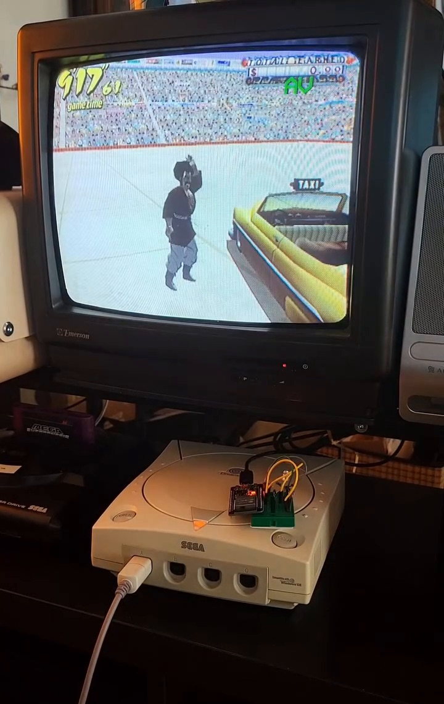</td>
  </tr>
  <tr>
    <td align="center" colspan="1"><a href="https://www.instagram.com/reel/DfmRFXWxy7w/">Mr. Satan Video</a></td>
  </tr>
</table>

<table>
  <tr>
    <td>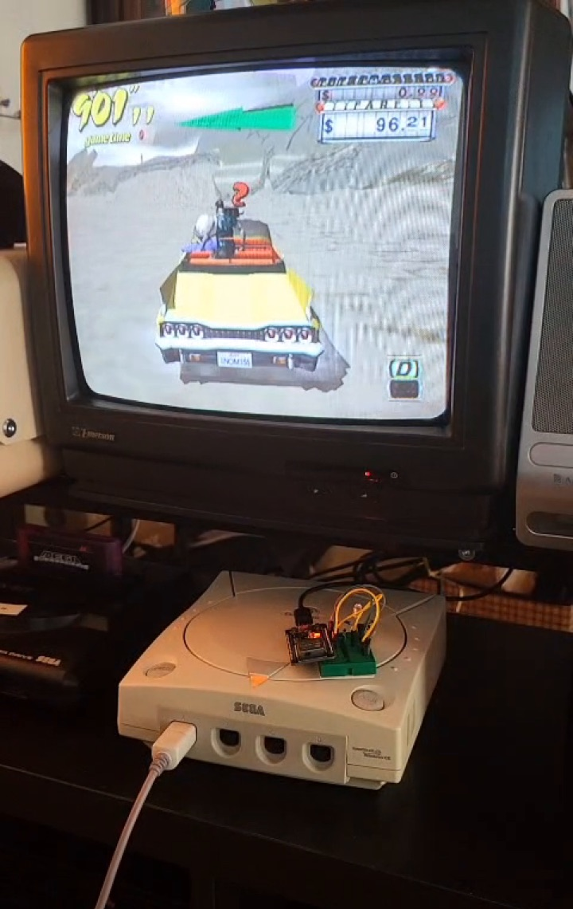</td>
    <td>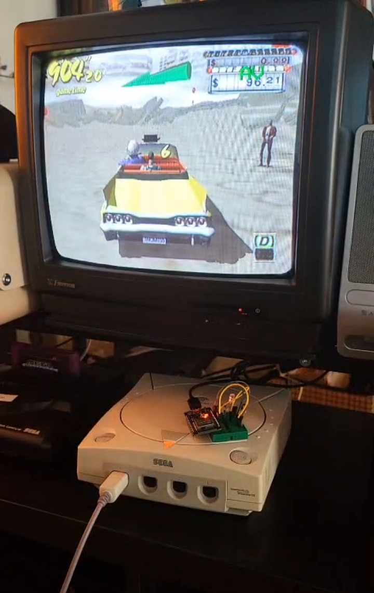</td>
  </tr>
  <tr>
    <td align="center" colspan="2"><a href="https://www.instagram.com/reel/DfmRFXWxy7w/">Future Trunks Video</a></td>
  </tr>
</table>

## The steps

This decomp follows the steps of the dc-decomp-kickoff skill: six from the disc to proven C for every function, then three to build, run and stabilise the game from that C, then the native port. `AGENTS.md` has the detail.

| # | Step                                    | Decomp completion                              | You provide                        | What it does                                                                                                                                                                                                                                                                                                               |
|---|-----------------------------------------|------------------------------------------------|------------------------------------|----------------------------------------------------------------------------------------------------------------------------------------------------------------------------------------------------------------------------------------------------------------------------------------------------------------------------|
| 1 | **Decomp project setup**                | -                                              | The disc as a `.gdi`, a Katana SDK | Installs the tools (Docker, Python 3) and checks your game disc and SDK.                                                                                                                                                                                                                                                   |
| 2 | **Signature-driven baseline**           | -                                              |                                    | Reads the disc, splits the executable into one assembly file per function, rebuilds it **byte for byte** with the SDK's own assembler and linker, and names every function it can match by signature.                                                                                                                      |
| 3 | **Asset mapping**                       | -                                              |                                    | Writes the text map (every string with its pointers, text per disc file), the model map, the texture list and the audio map.                                                                                                                                                                                               |
| 4 | **Opportunity-driven optional boosts**  | Varies greatly by project                      | The materials                      | Uses what you hand over to save work in every step after it, the earlier the better: a later port (Android is the strongest), a prototype or debug build, cheat codes, other regions, existing notes, the same game on another console, a sibling decomp. It never looks for these itself and never reads your other code. |
| 5 | **Incremental script-generated decomp** | up to 50%                                      | SDK library sources (optional)     | Proves C for what the tools can write on their own: the SDK's own library source where you have it, then generated C, then directed test cases that reach the branches the first ones missed. Generated C is reported apart from hand-written C.                                                                           |
| 6 | **Experience-driven agentic decomp**    | 100%                                           |                                    | Takes what is left one pocket at a time, function by function: C and test cases until each function is proven. The plan is in the repo's `AGENTS.md`.                                                                                                                                                                      |
| 7 | **Code size reduction**                 | -                                              |                                    | Shrinks the code compiled from the proven C to the size of the original game code. A smaller version of a function replaces the old one only if it is still equivalent to the original.                                                                                                                                    |
| 8 | **Build from C**                        | -                                              | The disc as a `.gdi`               | Builds the executable from the C and a disc image with it (`make disc GDI="your disc.gdi"`). Libraries, data and SDK stay as they are; pointers to game functions follow them.                                                                                                                                             |
| 9 | **Runtime repairs**                     | BOOTS TO MENU, PLAYABLE, STABLE (`status.txt`) | Flycast GDB                        | Runs the game using Flycast GDB, locates and tracks bugs and iterates builds until the game is stable.                                                                                                                                                                                                                     |
| 10 | **Native port**                         | Native column (`status.txt`)                   | Docker, the disc as a `.gdi`       | Builds the game from the proven C as an x86-64 Linux program and runs it outside the console (experimental). Every SDK function needs C except the hardware drivers.                                                                                                                                                       |

## Supported version

|                |                                                                   |
|----------------|-------------------------------------------------------------------|
| Release        | Crazy Taxi (Europe) (En,Ja), GD-ROM, MK-51035, V1.000, 2000-01-20 |
| `1ST_READ.BIN` | 1,477,040 bytes, SHA-1 `2756d6c828b5a3848189cd84cac62bc9cb0a94b7` |
| Linked at      | `0x0C010000`                                                      |
| SDK era        | Shinobi 1.62, KAMUI 1.11.0.1, ADXT 5.66                           |

Other releases are different builds: `setup.sh` refuses them rather than produce a broken split.

## What is here

**Instructions for agents and people working on the decomp**

| path           | what                                                                                                                                               |
|----------------|----------------------------------------------------------------------------------------------------------------------------------------------------|
| [AGENTS.md](AGENTS.md)    | The steps this decomp follows, and the per-function loop: Equivalent first, Matching as the bonus. The tools to try at step 6 are listed there |
| [KICKOFF](KICKOFF)      | The version of dc-decomp-kickoff this repo follows                                                                                                 |
| [.recomp.json](.recomp.json) | The project's metadata (game, version, status, approach) in the recomp.fyi format                                                                  |

**Documentation**

| path                             | what                                                                                                                                                   |
|----------------------------------|--------------------------------------------------------------------------------------------------------------------------------------------------------|
| [README.md](README.md)                      | This file                                                                                                                                              |
| [docs/engine.md](docs/engine.md) | The author's notes: the particularities of this game's code and data, and what was learned                                                             |
| [docs/equivalent.md](docs/equivalent.md)             | The evidence for each Equivalent function (written by [tools/equiv.py](tools/equiv.py))                                                                                |
| text-map/                      | (generated) The executable's strings, how much text each disc file holds, and every image file (`images.tsv`): counts and lists to read, not a verdict |

**The functions and their names**

| path                       | what                                                                                                                                    |
|----------------------------|-----------------------------------------------------------------------------------------------------------------------------------------|
| [functions.txt](functions.txt)            | Every function: address, size, name (`FUN_<addr>` = not named yet). The source of truth for boundaries; [asm/](asm/) is generated from it     |
| [globals.txt](globals.txt)              | Named globals: address and the original name                                                                                            |
| [symbols.txt](symbols.txt)              | Addresses the C units use that no file defines yet (RAM, data inside asm)                                                               |
| [sdk.txt](sdk.txt)                  | The bundled Sega SDK's code (for [tools/progress.py](tools/progress.py))                                                                                   |
| [models.txt](models.txt), [model-map/](model-map/) | What is known about the game's 3D models: tables whose layout is understood (read by [tools/3-assets/model_map.py](tools/3-assets/model_map.py)), and the map built from them |
| [BASE](BASE)                     | Link address                                                                                                                            |

**The C**

| path | what |
|---|---|
| [src/](src/) | C: Equivalent files (checked by [tools/equiv.py](tools/equiv.py), not built; the `gen_*.c` files were written by [tools/5-generated/gen_equiv](tools/5-generated/gen_equiv)) and matching C units (built, see below) |
| [partial/](partial/) | C that was written but did not pass the check: drafts, counted apart from done |
| [sdk-verified.txt](sdk-verified.txt) | Library functions whose bytes the SDK source you supplied reproduces (written by [tools/5-generated/sdk_source.py](tools/5-generated/sdk_source.py)) |
| [sdk-headers/](sdk-headers/), [sdk-patches.txt](sdk-patches.txt) | The SDK headers and the changes to the supplied sources that [tools/5-generated/sdk_source.py](tools/5-generated/sdk_source.py) needs |

**The proof**

| path | what |
|---|---|
| [tests/<file>/<function>.json](tests/) | The test cases of each function |
| [tests/equivalent.txt](tests/equivalent.txt) | The functions found Equivalent |
| [badges/](badges) | The progress badge, written by [tools/progress.py](tools/progress.py): `progress.svg`. It also shows the statuses of [status.txt](status.txt) that have two marks (BUILDS FROM C, BOOTS TO MENU, PLAYABLE, STABLE) as a grid, Dreamcast and Native, ticked, crossed, or a question mark where not tested yet (`[?]`); each needs the ones above it in its column |

**Scripts and tools**

| path | what |
|---|---|
| [setup.sh](setup.sh) | Extract and verify your executable, generate [asm/](asm/), [text-map/](text-map/) and [model-map/](model-map/) |
| [Makefile](Makefile) | The build commands: `make setup`, `make`, `make c`, `make disc`, `make progress` |
| [build.sh](build.sh) | Assemble, link, convert, compare with your original |
| [disc.sh](disc.sh) | Build a playable disc image of your version (files you put under `disc/`) |
| [textures.sh](textures.sh) | Optional: every standard texture on one page, to look through |
| [tools/](tools/README.md) | The tools several steps use: the Equivalent check (`equiv.py`), the SH-4 disassembler and simulator, progress and status reports, renaming |
| [tools/1-2-baseline/](tools/1-2-baseline/README.md) | Steps 1-2: splitting the executable, the C-unit layout, SDK naming |
| [tools/3-assets/](tools/3-assets/README.md) | Step 3: text map, model map, textures |
| [tools/4-boosts/](tools/4-boosts/README.md) | Step 4: names and C from a sibling decomp, checks against the running game |
| [tools/5-generated/](tools/5-generated/README.md) | Step 5: the generator (`gen_equiv/`), SDK source, what is left and why |
| [tools/6-agentic/](tools/6-agentic/README.md) | Step 6: cases written by hand, literal pools, code addresses |
| [tools/7-reduction/](tools/7-reduction/README.md) | Step 7: smaller C, still proven |
| [tools/8-build/](tools/8-build/README.md) | Step 8: the build from C and the disc image |

**Local only (git-ignored)**

| path | what | written by |
|---|---|---|
| 1ST_READ.BIN, asm/, objects.txt | Your executable and the assembly generated from it | [setup.sh](setup.sh) (with `tools/gdi_read.py` and `tools/1-2-baseline/split_asm.py`) |
| sdk-source/ | The C of the library functions, from the SDK source you supplied | `tools/5-generated/sdk_source.py` |
| build/ | Build output, the generator's log ([build/gen_run.log](build/gen_run.log)) and its report of why functions failed ([build/gen_failed.txt](build/gen_failed.txt)) | `make` (build/obj/, build/out.bin), `make c` (build/cbuild/), `tools/5-generated/gen_equiv` (its log and report) |
| state/ | Working state: notes, failed cases, the remaining-functions report ([state/remaining.md](state/remaining.md)) and its cache | `tools/5-generated/gen_equiv` (failed cases), `tools/5-generated/remaining.py` (the report), `tools/ledger.py` (notes) |

## Model map

`setup.sh` also builds `model-map/game.dcgs` (with `tools/3-assets/model_map.py`): every model it recognises in the disc files, the
table in the executable that holds it, the texture lists, every sound it recognises (CRI ADX and AHX streams, and the sound
banks), and, where a skeleton is known, characters assembled from their parts. It is plain tab-separated text in sections (`[models]`, `[assemblies]`, `[rigs]`, `[bones]`, `[audio]`, `[textures]`) and it is
**committed**: it holds addresses, offsets, sizes and names only, no game bytes or text (the text map is the one
that stays local). Regenerate it with `python3 tools/3-assets/model_map.py 1ST_READ.BIN "$(cat BASE)" functions.txt "<your disc>.gdi" model-map`.

- **No setup needed to start.** With no rules the map still lists every model it recognises, grouped by the table that holds it.
- **`models.txt` is what is known about the game's models**, one rule per line: `chars` and `structs` (tables whose
  layout is understood), `rig` / `bone` / `assemble` (a skeleton posed from a motion record), `nodes` / `nodelayout` (linked node structs in
  the executable, each character placed in its bind pose), `textures` (pairs a
  model file with a texture file of another name; matching names are found by themselves), `note`, and the two a
  person adds by naming things: `name <file> <offset> <text>` (one model), `sound <file> <entry> <text>` (one sound), `image <file> <offset> <text>` (one picture) and `table <address> <group> <label>`
  (a whole table). The syntax is in the header of `tools/3-assets/model_map.py`.
- **Naming convention.** A row shows the name first and the id beside it, and only the id when there is no name.
  Names are tidied the same way everywhere: words separated by single spaces (underscores and camelCase become
  spaces), each word starting with a capital, no parentheses. Ids (hex offsets, table addresses, the game's own
  identifiers) are never changed.
- **Naming things.** Edit `models.txt` and rerun the tool, or use a model viewer that opens this folder and writes
  the `name` and `table` lines for you, into two sorted blocks at the end of the file, so a naming session is a small
  `git diff`. Commit the diff.

## Equivalent C and shared library code

How strong an Equivalent function is depends on its test cases, so `tools/equiv.py` reports how many of the original's instructions they
run. The original's code is kept as one assembly file per function, the baseline the build keeps checking. C written by `tools/5-generated/gen_equiv` is
script-generated: it is checked on generated cases, which are then widened (`gen_equiv --direct` and `--retest`, and cases by hand for the branches
nobody ran). There is no pass mark: a function that passes is done, and the total test coverage on the badge says how strong the evidence is. `AGENTS.md` lists the steps this decomp follows.

`src/<file>.c` with no `@unit` header is C checked for behaviour only: `python3 tools/equiv.py src/<file>.c`
runs each function in an SH-4 interpreter twice per test case, the original bytes and your compiled C,
and they must agree on calls, memory writes and the result. Passing functions are listed in
`tests/equivalent.txt` and counted as done. The loop, and how to write many of them quickly, is in
`AGENTS.md` and the kickoff skill's `docs/equivalent-pipeline.md`.

## Matching C units (the build tier)

A file `src/<name>.c` whose first line is `/* @unit <start>-<end> [shc options] */` replaces every
asm file in that address range. `build.sh` compiles it with the SDK's `shc` to assembly, lays it
out exactly like the original (`tools/1-2-baseline/fill.py`: alignment as nops, reserved gaps as `0xEE`, padded
to `<end>`), assembles it and links it in place; the result still has to `MATCH`. A unit with
constant data (initialised local arrays, const tables, string literals) also names where the
original link put that data: `/* @unit <start>-<end> @data <dstart>-<dend> [shc options] */`. The
data becomes its own piece at that range, in source order; both ranges must start and end on asm
file boundaries (add them to `functions.txt`: `F <addr> 0 FUN_<addr>` for a function start,
`D <addr> 0 data_<addr>` for a data boundary, which is not counted as a function). A unit is one
original source file: all its functions share literal pools, so it goes in only when all of it
matches. A unit can sit in a folder of `src/` (`src/<dir>/<file>.c`) and name pieces of its own (`@ddata`, `@bdata`); options starting with `+` in the header
(`+pool32`, `+synth16`, `+r04`, ...) are opt-in layouts and compilers for the files that need them; a unit that asks for none gets the default layout.
`tools/fcmp.py` and `tools/permute.py` compare and rewrite a unit function by function. A game with code overlays builds them with
`bash build_overlays.sh`. The options and overlays are described in the kickoff skill's `docs/matching-units.md` and `docs/overlays.md`.
`python3 tools/progress.py` reports the state,
each function in one bucket: done (equivalent C; matching C and SDK source part of it), named only (a name is
not done work), unnamed; plus documented functions and named globals. `docs/equivalent.md` holds
the evidence for each equivalent function.

## Names

Names come from signature matching against the Katana SDK's own libraries (only unique matches are applied);
small wrappers inherit the name of the function they call.

## How this was started

This repo was autogenerated using
[dc-decomp-kickoff](https://github.com/consolesplayingconsoles/dc-decomp-kickoff) unstable. It follows the steps above; `AGENTS.md` says how.

## Third-party sources

The build needs a Katana SDK. Repositories that hold such material (for example
`Kochise/dreamcast-docs`)
are named solely as examples of the type of material required. We have no affiliation with, and
make no representation regarding, those repositories, their contents, or their licensing. You are
solely responsible for determining whether you are entitled to obtain and use any such material.

Crazy Taxi and its publisher's trademarks belong to their owners. This project is not affiliated with
or endorsed by them.

## Where this comes from

It came out of real work on Consoles Playing Consoles. See what Pluto has helped me build:

- 📸 **Instagram:** [@consolesplayingconsoles](https://www.instagram.com/consolesplayingconsoles/)
- 🔗 **Everything else:** [beacons.ai/consolesplayingconsoles](https://beacons.ai/consolesplayingconsoles)
